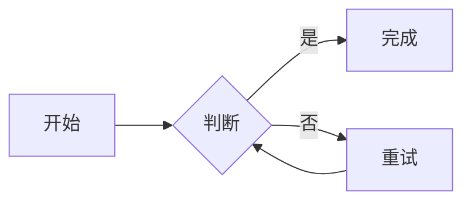
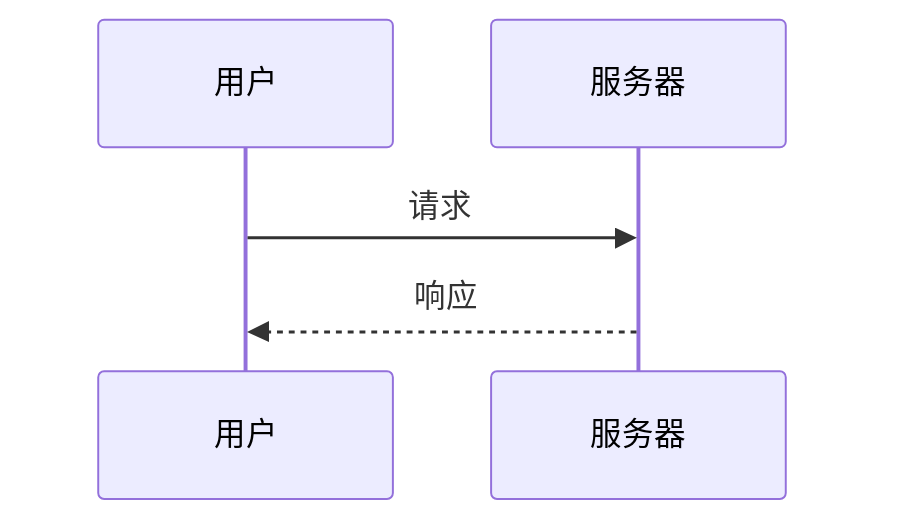

# Markdown 查看器测试

这是一段包含 **加粗**、*斜体*、~~删除线~~、`行内代码` 和自动链接 https://example.com 的文本。

## 表格

| 左对齐 | 居中 | 右对齐 |
| :--- | :---: | ---: |
| A | B | C |
| 1 | 2 | 3 |

## 任务列表

- [x] 已完成
- [ ] 未完成

## 代码

```js
const answer = 42;
function greet(name) {
  return `Hello, ${name}!`;
}
```

```python
def add(a, b):
    return a + b
```

```
plain code <tag> & stuff
inline $math$ should stay code
```

## Mermaid





## 数学公式

行内公式 $E = mc^2$，以及 \(a^2 + b^2 = c^2\)。

$$
\int_0^1 x^2 \, dx = \frac{1}{3}
$$

\[
\sum_{i=1}^{n} i = \frac{n(n+1)}{2}
\]

同行显示公式：$$y = x^2$$。

价格是 $5 和 $10，行内代码 `$not math$` 保持原样。

## 链接与图片

[相对链接](guide.md) 和 [外部链接](https://example.com/docs/other.md)


## 引用与列表

> 引用文本
>
> > 嵌套引用

1. 第一项
2. 第二项
   - 子项

---

## 原始 HTML

<strong>原始 HTML 的加粗</strong>

<script>window.__pwned = 1;</script>

<iframe src="https://example.com"></iframe>

<div style="color: red">带内联样式的 div</div>

## Mermaid 错误处理

```mermaid
this is not a valid diagram @@@
```
